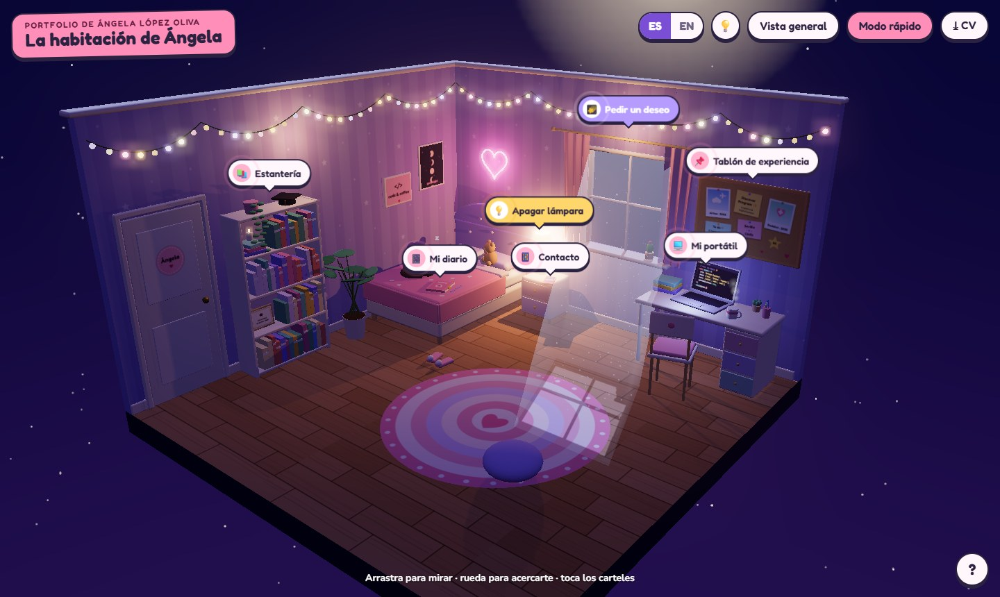
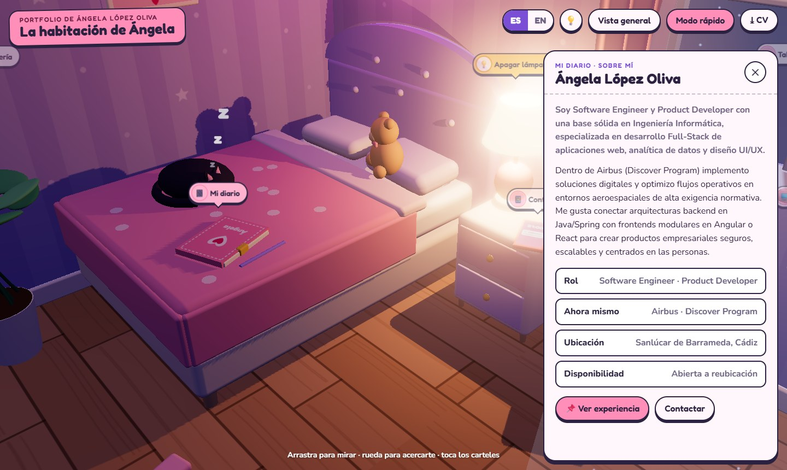
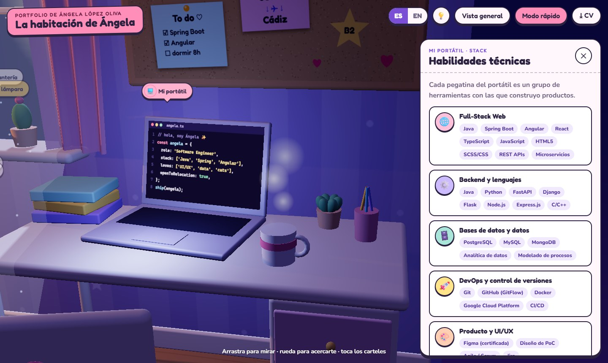
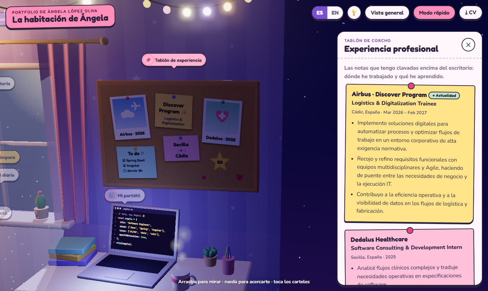
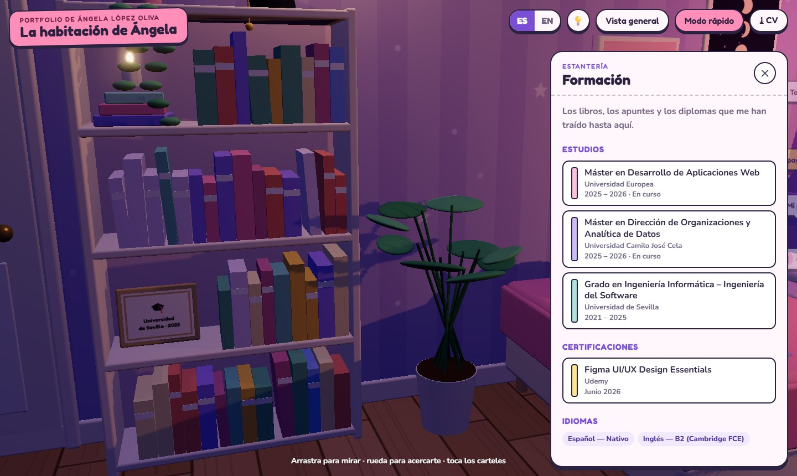
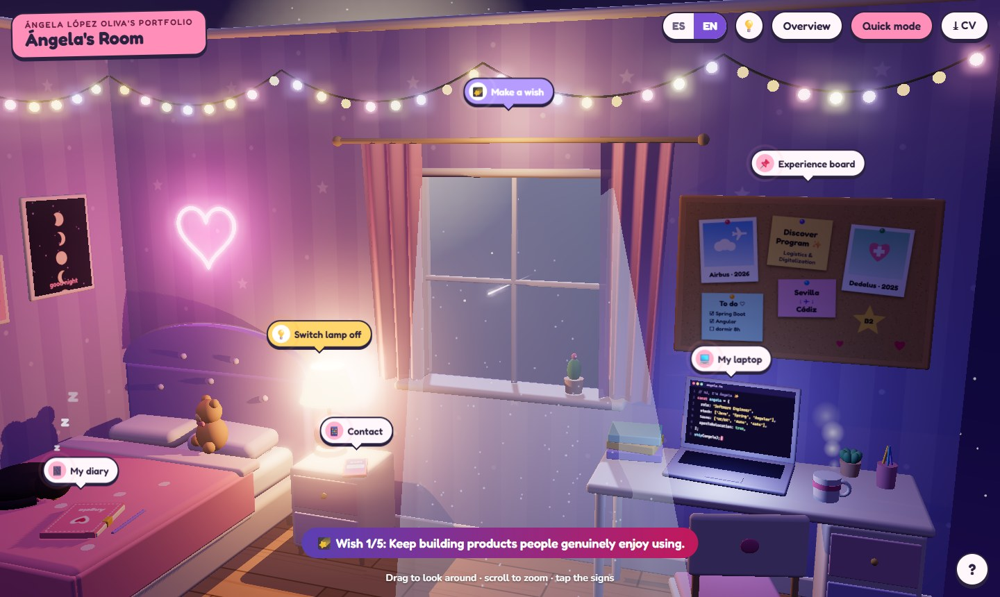
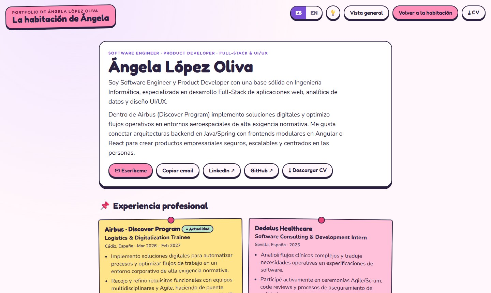
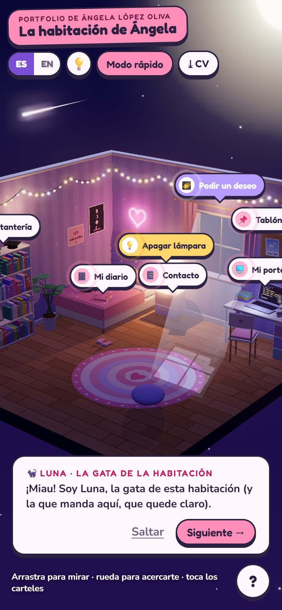

# 🌙 La habitación de Ángela · Portfolio 3D

Portfolio interactivo en 3D: una habitación de noche, flotando en un cielo estrellado, donde cada rincón guarda una parte de mi CV. Bilingüe (español / inglés).

**👉 [Ver la web en vivo](https://portfolio-v2-rosy-eight.vercel.app/)**



> Inspirado en la estructura de [El Muelle](https://github.com/ipiseradev/Portfolio-Ignacio): Three.js puro, sin framework de UI ni paso de build, y toda la geometría generada por código (sin modelos 3D externos).

## Capturas

| 📔 Diario · Sobre mí | 💻 Portátil · Stack |
| --- | --- |
|  |  |
| **📌 Tablón · Experiencia** | **📚 Estantería · Formación** |
|  |  |
| **🌠 Pedir un deseo (versión en inglés)** | **⚡ Modo rápido, sin 3D** |
|  |  |

<p align="center">
  
  <br><em>Versión móvil, con Luna dando la bienvenida</em>
</p>

## Qué hay en la habitación

| Objeto | Qué muestra |
| --- | --- |
| 📔 Diario sobre la cama | Sobre mí |
| 💻 Portátil del escritorio | Stack técnico (cada grupo es una pegatina) |
| 📌 Tablón de corcho | Experiencia profesional (Airbus, Dedalus) |
| 📚 Estantería | Formación, certificaciones e idiomas |
| 📱 Móvil de la mesita | Contacto, LinkedIn, GitHub y CV |
| 💡 Lámpara de la mesita | Se enciende y se apaga |
| 🌠 Ventana | Pide un deseo: cruza una estrella fugaz |
| 🐈‍⬛ Luna, la gata | La guía: tócala y te explica la habitación |

Además: luz de luna que entra por la ventana con polvo flotando, guirnaldas que titilan, corazón de neón, taza humeante, cursor parpadeando en el portátil, la hora real en el móvil, botón para encender la luz del cuarto y un **modo rápido** para leerlo todo sin 3D.

## Ejecutar en local

Los módulos ES no funcionan abriendo `index.html` con doble clic; hace falta un servidor estático:

```bash
python -m http.server 5180
```

y abrir <http://localhost:5180>.

## Estructura

- `index.html`: marcado y capas de interfaz (barra superior, panel, guía, loader)
- `main.js`: escena 3D, interacción y estado
- `content.js`: **todo el contenido editable** (perfil, experiencia, formación, stack, deseos, textos ES/EN)
- `style.css`: estilos de la interfaz
- `cv.pdf`: CV descargable
- `docs/screenshots/`: capturas para este README

Para cambiar textos o datos, basta con editar `content.js`.

## Despliegue

Es un sitio estático: funciona tal cual en GitHub Pages, Netlify, Vercel o Cloudflare Pages.

## Contacto

- ✉️ angelalopezoliva03@gmail.com
- 💼 [LinkedIn](https://www.linkedin.com/in/angela-lopez03)
- 🐙 [GitHub](https://github.com/angelalop03)
