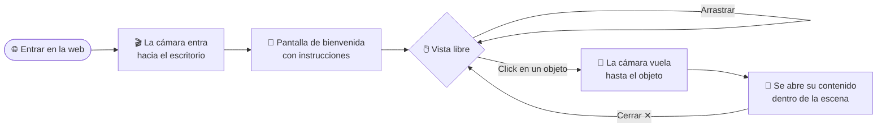
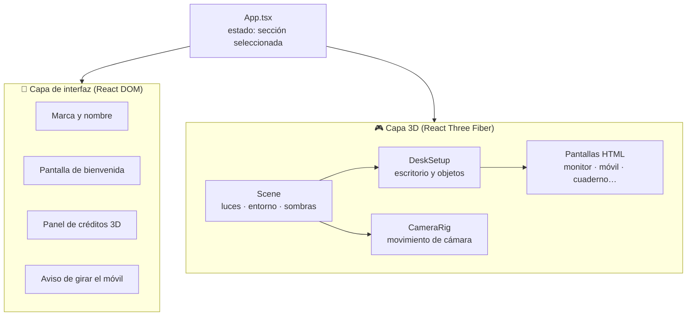

<div align="center">

# 🖥️✨ Portfolio 3D · Ángela López Oliva

### Un portfolio que no se lee: se explora

Escritorio 3D interactivo en el navegador. Cada objeto de la mesa esconde una parte de mi perfil profesional.

<br/>

[](https://portfolio-v2-rosy-eight.vercel.app/)

<br/>


</div>

---

## 📖 Índice

- [La idea](#-la-idea)
- [Qué hay en el escritorio](#-qué-hay-en-el-escritorio)
- [Cómo se navega](#-cómo-se-navega)
- [Tecnologías](#️-tecnologías)
- [Cómo está construido](#-cómo-está-construido)
- [Retos técnicos resueltos](#-retos-técnicos-resueltos)
- [Estructura del proyecto](#-estructura-del-proyecto)
- [Ejecutar en local](#-ejecutar-en-local)
- [Créditos](#-créditos)

---

## 💡 La idea

La mayoría de portfolios siguen el mismo esquema: cabecera, "sobre mí", proyectos y contacto, uno debajo de otro. Quería algo que se recordara y que, de paso, demostrara lo que sé hacer.

Por eso este portfolio es **mi escritorio de trabajo convertido en una escena 3D**. En lugar de hacer scroll, el visitante gira la cámara alrededor de la mesa y hace click en los objetos que le llaman la atención. La cámara vuela hasta ese objeto y el contenido aparece **integrado en él**: los proyectos se abren en la pantalla del monitor, la experiencia se escribe en las páginas del cuaderno y el contacto aparece en la pantalla del móvil.

> 🎯 **Objetivo:** que la propia web funcione como proyecto de muestra, combinando desarrollo frontend, gráficos 3D y cuidado por la experiencia de usuario.

---

## 🗂️ Qué hay en el escritorio

| | Objeto | Sección | Qué encontrarás |
|:-:|---|---|---|
| 🖥️ | **Monitor** | Proyectos | Una ventana estilo macOS con mis proyectos: descripción, stack y enlaces a cada repositorio. Tiene botones propios para desplazarse por la lista. |
| ⌨️ | **Teclado** | Habilidades | Un teclado mecánico en el que cada tecla de letra es una tecnología, coloreada según su categoría. |
| 📓 | **Cuaderno** | Experiencia | Un cuaderno de anillas abierto con mis prácticas y puestos, escrito como si fueran notas a mano. |
| 🖼️ | **Marco de fotos** | Sobre mí | Mi foto junto a una tarjeta con mi perfil y lo que me define como profesional. |
| 📱 | **Móvil** | Contacto | Una tarjeta de contacto en la pantalla del teléfono: email, GitHub y ubicación. |
| 🎧 | **Cascos** | Música | Un reproductor de Spotify con la playlist que escucho mientras programo. |
| 📌 | **Corcho** | Formación | Notas clavadas en la pared con mis titulaciones y certificaciones. Cada nota se amplía al hacer click. |

<details>
<summary><b>⌨️ Ver las tecnologías que aparecen en el teclado</b></summary>

<br/>

| Categoría | Tecnologías |
|---|---|
| **Backend** | Java · Spring Boot · Python · Django · Flask · FastAPI · Node.js · Express.js |
| **Frontend** | HTML5 · CSS3 · JavaScript · TypeScript · Angular · React · React Native |
| **Bases de datos** | MongoDB · MySQL · PostgreSQL |
| **DevOps y cloud** | Git y GitHub · Docker · Google Cloud |
| **Diseño y metodología** | Figma · Agile/Scrum · Jira |

</details>

<details>
<summary><b>📌 Ver la formación que aparece en el corcho</b></summary>

<br/>

- 🎓 Grado en Ingeniería Informática · Universidad de Sevilla
- 🎓 Máster en Desarrollo de Aplicaciones Web · Universidad Europea
- 🎓 Máster en Organizaciones y Analítica de Datos · Universidad Camilo José Cela
- 🇬🇧 Cambridge English B2 · First Certificate in English (FCE)
- 🎨 Figma UI/UX Design Essentials · Udemy
- 🤖 Vibe Coding Práctico: Desarrollo de Apps con IA desde Cero · Udemy

</details>

---

## 🧭 Cómo se navega



- **Arrastrar** con el ratón gira la vista alrededor del escritorio.
- **Pasar el ratón** por encima de un objeto lo resalta y lo agranda un poco, para indicar que se puede pulsar.
- **Hacer click** lleva la cámara hasta el objeto y abre su sección.
- **Cerrar (✕)** devuelve la cámara a la vista general.
- En **móvil**, la web pide girar el dispositivo a horizontal para verse correctamente.

---

## 🛠️ Tecnologías

| Herramienta | Para qué la uso |
|---|---|
| **React 19** | Estructura de la aplicación y gestión del estado (qué sección está abierta, la bienvenida, los créditos) |
| **TypeScript** | Tipado de componentes, posiciones 3D y datos de contenido |
| **Three.js** | Motor de renderizado 3D en el navegador (WebGL) |
| **React Three Fiber** | Escribir la escena 3D como componentes de React |
| **Drei** | Utilidades para R3F: controles de cámara, HTML dentro de la escena, sombras, entorno de iluminación y carga de modelos |
| **Vite** | Servidor de desarrollo rápido y build de producción |
| **Oxlint** | Linter para mantener el código limpio |
| **Vercel** | Despliegue continuo desde GitHub |

---

## 🏗️ Cómo está construido

La aplicación se divide en dos capas que conviven en la misma pantalla:



1. **`App.tsx`** guarda qué sección está seleccionada y pinta por encima la interfaz plana (bienvenida, créditos, pistas).
2. **`Scene.tsx`** monta el lienzo 3D, las luces, las sombras y define **una posición de cámara para cada objeto**.
3. **`DeskSetup.tsx`** coloca el escritorio y envuelve cada objeto interactivo en un componente `Hotspot`, que gestiona el hover, el click y el resaltado.
4. **`CameraRig.tsx`** anima la cámara de forma suave entre la vista general y el objeto elegido.
5. Cada sección (`MonitorScreen`, `PhoneScreen`, `NotebookScreen`…) es **HTML real colocado dentro del mundo 3D**, pegado a la superficie de su objeto.

---

## 🧠 Retos técnicos resueltos

<details>
<summary><b>🔍 Texto nítido dentro de una escena 3D</b></summary>

<br/>

Al colocar HTML dentro de la escena y acercar la cámara, el texto se veía borroso: el navegador lo dibujaba pequeño y luego lo ampliaba.

**Solución:** cada pantalla se maqueta varias veces más grande de lo necesario y se reduce con una transformación CSS. Así el navegador siempre dibuja el texto a buen tamaño y solo lo encoge, nunca lo amplía.

</details>

<details>
<summary><b>📐 Ángulos de cámara pensados para cada objeto</b></summary>

<br/>

El texto sobre un plano inclinado se deforma con la perspectiva, por mucha resolución que tenga.

**Solución:** cada objeto tiene su propia posición de cámara. Los que están tumbados en la mesa (móvil, cuaderno, teclado) se miran casi desde arriba, y los que están de pie (monitor, marco, cascos) se miran de frente. Así el contenido siempre se lee recto.

</details>

<details>
<summary><b>✨ Objetos que parpadeaban sobre la alfombrilla</b></summary>

<br/>

El teclado, el ratón y el cuaderno compartían exactamente la misma altura que la superficie de la alfombrilla, y la GPU no sabía cuál dibujar delante (lo que se conoce como *z-fighting*).

**Solución:** se midió el grosor real de la alfombrilla una vez cargada y los objetos se colocan justo encima de ella.

</details>

<details>
<summary><b>📦 Modelos 3D con medidas incorrectas</b></summary>

<br/>

Algunos modelos descargados traían metadatos de tamaño erróneos, así que quedaban flotando o hundidos en la mesa.

**Solución:** el componente `Model` calcula la caja real del modelo después de cargarlo y lo apoya automáticamente sobre la superficie. Las rotaciones se definen como constantes para evitar recálculos en cada render, que hacían temblar algunos objetos al pasar el ratón.

</details>

<details>
<summary><b>💡 Iluminación realista sin descargas extra</b></summary>

<br/>

Los materiales realistas (PBR) necesitan un entorno que reflejar, que normalmente es una imagen HDRI externa y pesada.

**Solución:** el entorno se genera dentro de la propia escena con varios paneles de luz (`Lightformer`) en tonos blancos y rosados, a juego con la estética de la web.

</details>

---

## 📁 Estructura del proyecto

```
Landing_Page/
├── public/
│   └── models/                 # Modelos 3D en glTF con sus texturas y licencias
│       ├── desk/  monitor/  keyboard2/  mouse/  deskmat/
│       ├── iphone/  headphones/  notebook/  coffee-cup/
│       └── white-photo-frame/  corkboard/
│
└── src/
    ├── App.tsx                 # Estado global e interfaz superpuesta
    ├── credits.ts              # Atribución de cada modelo 3D
    └── scene/
        ├── Scene.tsx           # Lienzo, luces, entorno y cámaras por objeto
        ├── DeskSetup.tsx       # Composición del escritorio y hotspots
        ├── CameraRig.tsx       # Transiciones de cámara
        ├── Model.tsx           # Carga y colocación de modelos glTF
        ├── MonitorScreen.tsx   # 🖥️ Proyectos
        ├── KeyboardScreen.tsx  # ⌨️ Habilidades
        ├── NotebookScreen.tsx  # 📓 Experiencia
        ├── PhotoFrameScreen.tsx# 🖼️ Sobre mí
        ├── PhoneScreen.tsx     # 📱 Contacto
        ├── MusicPlayer.tsx     # 🎧 Playlist de Spotify
        └── Diplomas.tsx        # 📌 Formación en el corcho
```

---

## 🚀 Ejecutar en local

**Requisitos:** Node.js 20 o superior y npm.

```bash
# 1. Clonar el repositorio
git clone https://github.com/angelalop03/Landing_Page.git
cd Landing_Page

# 2. Instalar dependencias
npm install

# 3. Arrancar el servidor de desarrollo
npm run dev
```

Abre la dirección que muestra la terminal (por defecto `http://localhost:5173`).

| Comando | Descripción |
|---|---|
| `npm run dev` | Servidor de desarrollo con recarga en caliente |
| `npm run build` | Comprueba los tipos y genera la build de producción en `dist/` |
| `npm run preview` | Sirve en local la build de producción |
| `npm run lint` | Analiza el código con Oxlint |

---

## 🙏 Créditos

Los modelos 3D son de [Sketchfab](https://sketchfab.com) y se usan bajo licencia **[CC BY 4.0](https://creativecommons.org/licenses/by/4.0/)**. Gracias a sus autores:

| Modelo | Autor |
|---|---|
| Monitor (Low-Poly) | [pevofficialll](https://sketchfab.com/pevofficialll) |
| Mechanical Keyboard - Aesthetic | [M.Reslan](https://sketchfab.com/mreslan) |
| Table Desk | [adventurer](https://sketchfab.com/ahmagh2e) |
| Logitech Deskmat Pink | [PolyDavid](https://sketchfab.com/PolyDavid) |
| Modern Headphones | [mirkuwu](https://sketchfab.com/mirkobuitre317) |
| Coffee Cup | [AK STUDIO](https://sketchfab.com/inven2000) |
| Notebook | [demagdev](https://sketchfab.com/demagdev) |
| Cork Board | [Spacesea](https://sketchfab.com/-Spacesea-) |
| iPhone 11 | [atomle](https://sketchfab.com/atomle) |
| White Photo Frame | [Johana-PS](https://sketchfab.com/Johana-PS) |

La atribución también es visible en la web, en el botón **Créditos 3D**.

---

<div align="center">

### 👩‍💻 Hecho con ☕ y mucho cariño por **Ángela López Oliva**

[](https://github.com/angelalop03)
[](mailto:angelalopezoliva03@gmail.com)
[](https://portfolio-v2-rosy-eight.vercel.app/)

⭐ Si te ha gustado, ¡déjale una estrella al repo!

</div>
